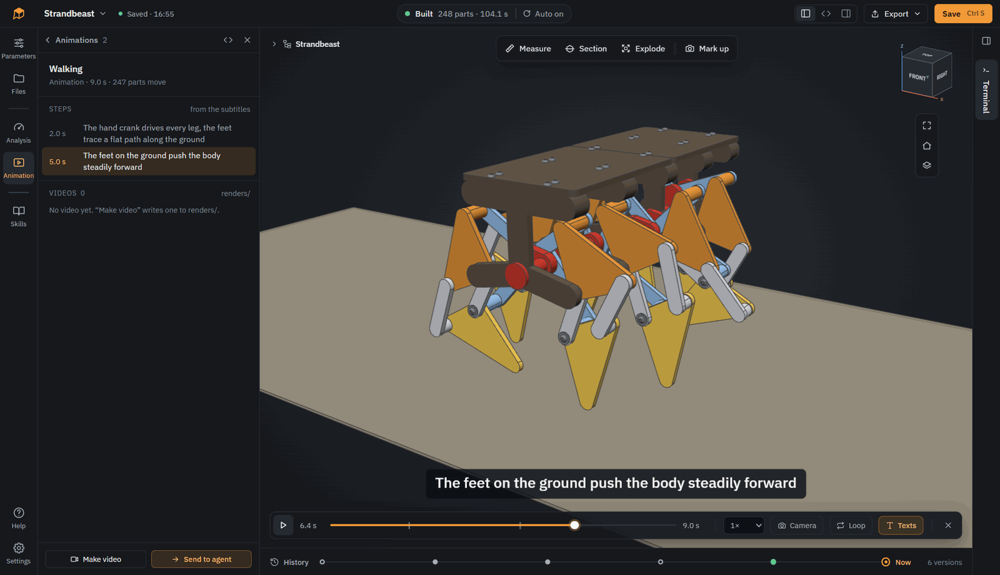
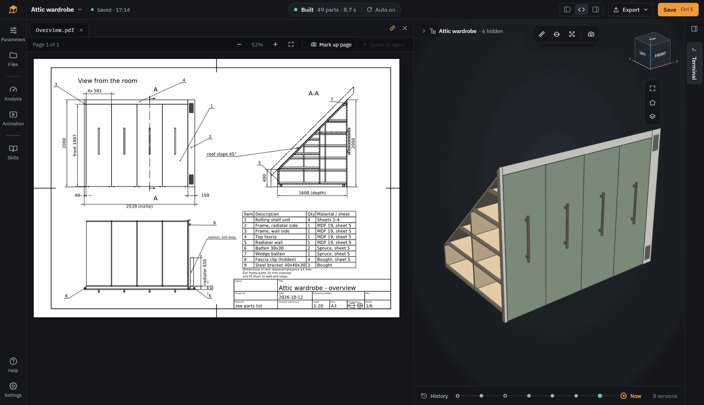

# SOMA

**Solid Object Modeling with Agents.** A desktop app for designing parametric 3D models together with a coding agent.

<!-- Trailer: upload the MP4 in the GitHub web editor and put the user-attachments link here, the hero image moves to Screenshots -->


https://github.com/user-attachments/assets/3294d1e4-1f06-477d-9770-c91f3470330d


You tell the agent what you need. It writes the model as Python code with [CadQuery](https://github.com/CadQuery/cadquery), SOMA builds it and shows the result. You look at it, measure it, point at what is wrong, and the agent changes the code.

## What it is

It's vibe coding, but for CAD. Made for makers and tinkerers who need a case, a bracket or a mount for their project and don't want to spend hours in a CAD program to get it. Describe or sketch the part, check the result, export it, print it. You don't have to know CadQuery. The code is there if you want to change a dimension yourself.

SOMA is not an agent of its own. Any CLI agent that can read files and run commands works: Claude Code, OpenCode, Codex CLI, Gemini CLI or whatever comes next. It runs in a normal terminal inside the model folder, SOMA detects the common ones and can start them. You install and log in to them yourself, so your subscription, your model choice and your permission settings stay yours. SOMA gives the agent a command line tool (`soma build`, `soma analyze`, `soma render` …) and an `AGENTS.md` with the rules of the project.

## Install

Download the package for your system from the [releases](https://github.com/Kai-Jungsthoefel/SOMA/releases): an installer for Windows, an AppImage or tar.gz for Linux, a dmg for macOS (Apple Silicon). Python, CadQuery, Git and CalculiX are included.

- You need a CLI agent installed and logged in, for example Claude Code, OpenCode, Codex CLI or Gemini CLI. SOMA does not bring one
- The installed app takes over 1 GB of disk space, most of it for Python, CadQuery and OpenCascade
- The packages are not signed yet. On Windows, SmartScreen warns on the first start ("More info" > "Run anyway"). On macOS, open the app the first time with right-click > Open
- Linux needs glibc 2.31 or newer
- There is no automatic update. Download a new version from the releases page

## Quick start

1. Start SOMA and click **New model** on the start page. It starts from a small example, a box with a lid.
2. Start your agent with the **+** above the terminal on the right. SOMA lists the agents it found on your computer.
3. Tell the agent what you need, for example *"A case for a Raspberry Pi 5 with vents in the lid, printed in PETG"*. SOMA builds the model on every change and shows it.
4. Click parts, measure, or draw on the view and send it to the agent until it fits. Then export it from the menu, for example as STL or 3MF.

Press F1 in the app for a short guide with numbered screenshots. The agent knows the same guide, so you can also just ask it how something works.

## Features

- **Models as code:** Python with CadQuery, rebuilt on every change
- **One file per model:** a `.soma` file holds code, result and history, like a CAD file
- **Point, measure, draw:** click a part, measure exactly or sketch on the view, and send it to the agent
- **Parameters:** change the values the agent made adjustable, without touching the code
- **History:** every step of the agent on a timeline, preview and restore old states
- **Skills:** rule sets for the agent, such as 3D printing, CNC, laser cutting, sheet metal and tolerances, switched on per model. Edit them or add your own
- **Analysis and animation:** overhangs, wall thickness, strength with FEM, animations as video
- **Export:** STEP, STL, 3MF, DXF and more, technical drawings as PDF

## Screenshots

**Explode:** take your assembly apart. SOMA works out in which direction each part comes off.


**Animate:** bring your models to life. Animations are created by your agent and rendered to video.



**Draw:** technical drawings from the model. The agent writes them in Python, with views, sections and dimensions measured on the model, as PDF and DXF.



## Status

Early prototype, version 0.7.2. See [CHANGELOG.md](CHANGELOG.md).

- Developed and mainly tested on Windows. The packages also run on Linux (Kubuntu) and macOS (Apple Silicon), but have seen much less use there
- Mostly tested with Claude Code and Claude Opus 5.5 as the agent's model, with very good results. Other agents and models work too
- File formats and the `soma` API may still change between 0.x versions

> **Note:** SOMA itself is vibe coded. Most of the code was written by coding agents (mainly Claude Code) under human direction and review. It has tests, but expect rough edges.

## Feedback

Bug reports, ideas and experiences with different agents are very welcome as [issues](https://github.com/Kai-Jungsthoefel/SOMA/issues/new/choose). Pull requests are not accepted for now, see [CONTRIBUTING.md](CONTRIBUTING.md).

## Running from source

For development. The setup script is for Windows only. Requirements: Windows, Node.js 22, Python 3.12 and [uv](https://github.com/astral-sh/uv).

```
powershell -File python/scripts/setup_env.ps1
cd app
npm install
npm start
```

More in [app/README.md](app/README.md).

## License

SOMA is free software under the [GNU General Public License v3.0](LICENSE) or any later version. You can use, change and share it. If you distribute a changed version, its source code has to be open under the same license.

What you design with SOMA is yours. The [SOMA Model Exception](MODEL-EXCEPTION.md) lets you license your model files under any terms you like, even though they import `soma`. Exported files like STEP or STL are not affected by the GPL at all.

Third-party components keep their own licenses, see [THIRD_PARTY_NOTICES.md](THIRD_PARTY_NOTICES.md).
