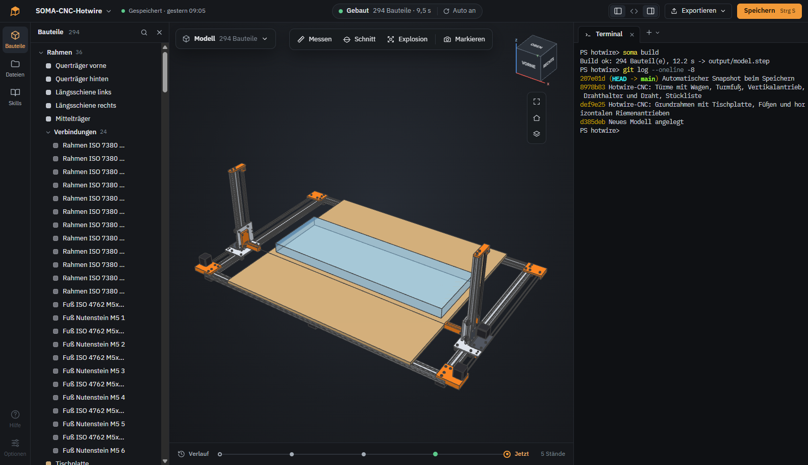
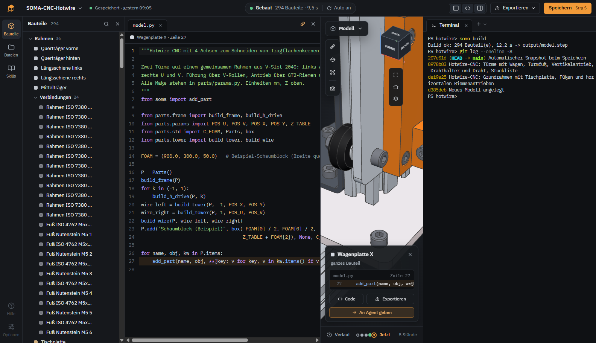
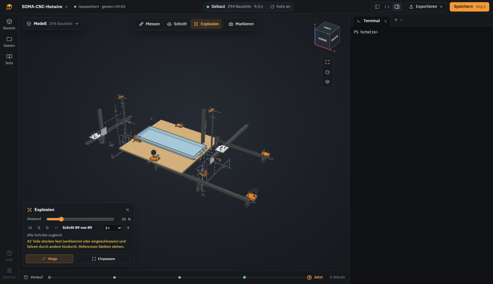
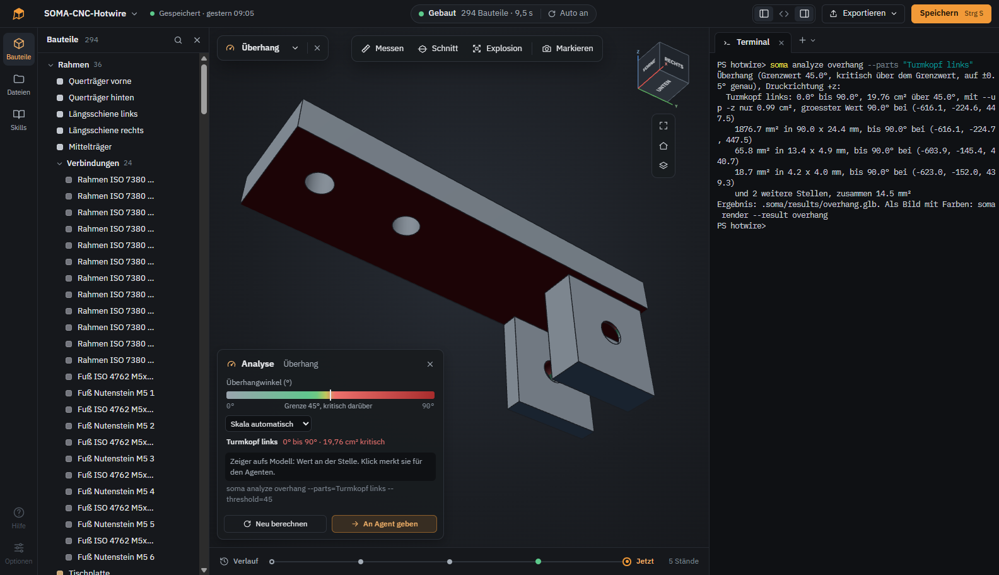

# SOMA

**Solid Object Modeling with Agents.** A desktop app for designing parametric 3D models together with a coding agent.




You tell the agent what you need. It writes the model as Python code with [CadQuery](https://github.com/CadQuery/cadquery), SOMA builds it and shows the result. You look at it, measure it, point at what is wrong, and the agent changes the code.

## What it is

SOMA puts a few things into one window:

- **3D viewer** for the model the agent builds, with measuring, sections and exploded views
- **IDE**: terminal for the agent, code editor, file tree and version history
- **Sketch tool**: draw on the view or on a photo of a hand sketch to show the agent what you mean
- **Instructions for the agent**: `AGENTS.md` and `CLAUDE.md` with the rules of the project, plus skills for 3D printing, CNC, tolerances and more
- **Helper tools**: the `soma` command line for building, analysis, rendering and standard parts

## Who it is for

Makers and tinkerers who need a case, a bracket or a mount for their project and don't want to spend hours in a CAD program to get it. Describe or sketch the part, check the result, export it, print it.

It's vibe coding, but for CAD. You don't have to know CadQuery. The code is there if you want to change a dimension yourself.

## Use the agent you already have

SOMA is not an agent harness of its own. The agent runs in a normal terminal inside the model folder. SOMA gives it a command line tool (`soma build`, `soma analyze`, `soma render` …) and an `AGENTS.md` with the rules of the project.

Any CLI agent that can read files and run commands works: Claude Code, OpenCode, Codex CLI, Gemini CLI or whatever comes next. SOMA detects the common ones and can start them. You install and log in to them yourself, so your subscription, your model choice and your permission settings stay yours.

## Features

**Modeling**
- Models are Python files (`model.py`, optional `parts/`) using CadQuery and a small helper library
- Builds on every change, errors point to file and line
- Named parts, groups and sub-assemblies, STEP import of single parts and whole assemblies
- Standard parts (ISO/DIN screws, nuts, washers, heat-set inserts) with matching holes and nut traps
- Extra Python packages: the agent runs `pip install`, SOMA records them in `requirements.txt` and reinstalls them on another machine

**Looking at the result**
- Click a part to jump to the line of code that created it
- Exact measurements on the B-rep, not on the mesh: faces, edges, distances, hole spacing
- Section views, exploded views with a disassembly analysis, transparency and isolation per group
- Analysis: overhangs, wall thickness, clearance between parts, strength with FEM
- Animations written in Python, rendered to images and MP4

**Feedback to the agent**
- Send a selection, a measurement or a section to the agent with one click
- Draw on the 3D view, or drop in a photo of a hand sketch and draw on that, then hand the image to the agent
- `soma render` lets the agent look at its own work as images or contact sheets
- Skills: optional rule sets per model (3D printing, CNC, sheet metal, tolerances, joints, FEM …), switched on always or on demand

**Project**
- A model is a single ZIP file with code, result and history
- Every commit of the agent shows up on a timeline below the view, old states can be previewed and restored
- Export to STEP, STL, 3MF, glTF, DXF, SVG and more

## Screenshots

Click a part and SOMA shows where it comes from in the code.



Exploded view. SOMA works out in which direction each part can be removed.



Overhang analysis of a 3D printed part. The agent ran `soma analyze` in the terminal, the critical underside is marked red.



## What a model looks like

```python
import cadquery as cq
from soma import add_part

LENGTH, WIDTH, HEIGHT, WALL = 60.0, 40.0, 25.0, 2.0

body = (
    cq.Workplane("XY")
    .box(LENGTH, WIDTH, HEIGHT, centered=(True, True, False))
    .edges("|Z").fillet(3.0)
    .faces(">Z").shell(-WALL)
)
add_part("Body", body, color=(0.25, 0.45, 0.75))
```

`soma build` runs the file and writes `output/model.step` with every part named, plus the data for the viewer.

## Status

Early prototype, version 0.1.0. See [CHANGELOG.md](CHANGELOG.md).

- Developed and tested on Windows only
- No installer yet. Python, CadQuery and Git are meant to ship with the app, for now you set them up yourself

> **Note:** SOMA itself is vibe coded. Most of the code was written by coding agents (mainly Claude Code) under human direction and review. It has tests, but expect rough edges.

## Running from source

Requirements: Windows, Node.js 22, Python 3.12 and [uv](https://github.com/astral-sh/uv).

```
powershell -File prototype/phase0/setup_env.ps1
uv pip install --python "$env:LOCALAPPDATA/cadide-phase0/venv-full/Scripts/python.exe" -e python
cd app
npm install
npm start
```

More in [app/README.md](app/README.md).

## Repository

| Path | Content |
|---|---|
| `app/` | Electron app (TypeScript): terminal, viewer, project format, tests |
| `python/soma/` | Helper library and command line tool used by the agent |
| `design/` | UI drafts |
| `PLAN.md`, `DECISIONS.md` | Plan and decision log (German) |

## License

SOMA is free software under the [GNU General Public License v3.0](LICENSE) or any later version. You can use, change and share it. If you distribute a changed version, its source code has to be open under the same license.

What you design with SOMA is yours. The [SOMA Model Exception](MODEL-EXCEPTION.md) lets you license your model files under any terms you like, even though they import `soma`. Exported files like STEP or STL are not affected by the GPL at all.

Third-party components keep their own licenses. Among them are CadQuery (Apache-2.0), OpenCascade (LGPL-2.1), Git (GPL-2.0), gmsh (GPL-2.0-or-later) and pdf.js (Apache-2.0).
