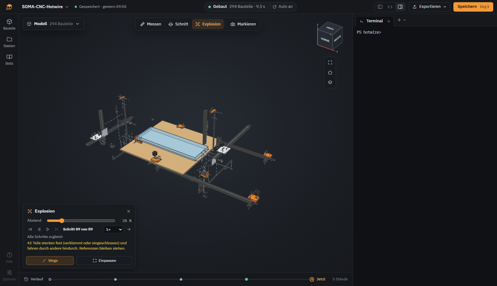
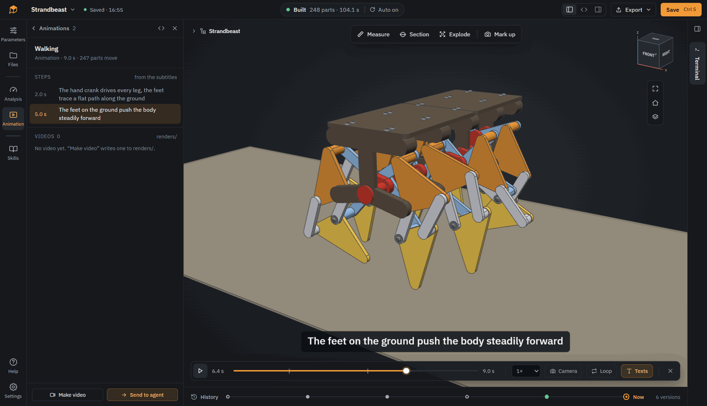
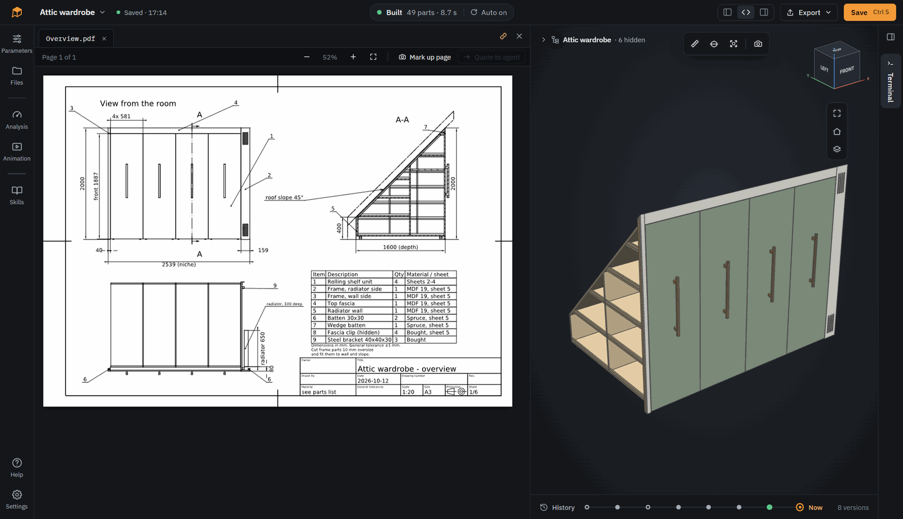

# SOMA

[English](README.md) · **简体中文**

> **AI translation / AI 翻译：** This page was translated from the [English README](README.md) by an AI and has not been checked by the maintainer, who does not read Chinese. If anything differs, the English version applies.
>
> 本页由 AI 从[英文 README](README.md) 翻译而来，维护者不懂中文，未经人工校对，可能存在错误。如有出入，以英文版为准。软件界面目前只有英文。

**Solid Object Modeling with Agents（用智能体进行实体建模）。** 一款桌面应用，让你与编程智能体（coding agent）一起设计参数化 3D 模型。

**[somacad.app](https://somacad.app)** · [下载](https://somacad.app/download/) · [更新日志（英文）](CHANGELOG.md)

https://github.com/user-attachments/assets/3294d1e4-1f06-477d-9770-c91f3470330d


你告诉智能体你需要什么。它用 [CadQuery](https://github.com/CadQuery/cadquery) 把模型写成 Python 代码，SOMA 构建模型并显示结果。你查看、测量、指出哪里不对，智能体再修改代码。

## SOMA 是什么？

一款由 AI 来做 CAD、你来当设计师的 CAD 程序。SOMA 把所需的三部分整合在一起：带终端的代码工作区（供智能体使用）、编辑器以及记录每个版本的 Git；每次修改都会重新构建模型的 3D 查看器；以及给智能体的说明，包括规则、技能（skills）和一个命令行工具。

这就是 CAD 版的 vibe coding。它面向创客和爱好者：你的项目需要一个外壳、一个支架或一个安装座，又不想花几个小时在 CAD 软件里画。描述或草绘零件，检查结果，导出，打印。你不需要懂 CadQuery。如果想亲手改一个尺寸，代码就在那里。

SOMA 本身不是智能体。任何能读取文件并运行命令的 CLI 智能体都可以使用：Claude Code、OpenCode、Codex CLI、Gemini CLI，或者以后出现的其他工具。它运行在模型文件夹中的普通终端里，SOMA 能识别常见的智能体并启动它们。智能体由你自己安装和登录，因此订阅、模型选择和权限设置都由你掌控。SOMA 为智能体提供一个命令行工具（`soma build`、`soma analyze`、`soma render` …）和一个写有项目规则的 `AGENTS.md`。

## 安装

从 [somacad.app/download](https://somacad.app/download/)（会为你的系统推荐合适的安装包）或 [releases](https://github.com/Kai-Jungsthoefel/SOMA/releases) 页面下载 SOMA：Windows 有安装程序或便携版 ZIP，Linux 有 AppImage 或 tar.gz，macOS（Apple Silicon）有 dmg。已内置 Python、CadQuery、Git 和 CalculiX。

- 你需要一个已安装并登录的 CLI 智能体，例如 Claude Code、OpenCode、Codex CLI 或 Gemini CLI。SOMA 不自带智能体
- 安装后的应用占用超过 1 GB 磁盘空间，大部分用于 Python、CadQuery 和 OpenCascade
- 安装包尚未签名。在 Windows 上首次启动时 SmartScreen 会发出警告（点击“More info”>“Run anyway”）。使用便携版 ZIP 时，解压前在文件属性中勾选“Unblock”（解除锁定）即可避免警告，并解压到本地文件夹。在 macOS 上，首次打开请右键点击应用 > 打开
- Linux 需要 glibc 2.31 或更新版本
- 有新版本时，SOMA 会在起始页上提示。请从网站或 releases 页面下载

## 快速开始

1. 启动 SOMA，在起始页点击 **New model**（新建模型）。它从一个小示例开始：一个带盖的盒子。
2. 用右侧终端上方的 **+** 启动你的智能体。SOMA 会列出在你电脑上找到的智能体。
3. 告诉智能体你需要什么，例如 *“A case for a Raspberry Pi 5 with vents in the lid, printed in PETG”*（一个树莓派 5 外壳，盖子上有通风孔，用 PETG 打印）。也可以用中文描述，取决于你的智能体和模型。SOMA 在每次修改后构建并显示模型。
4. 点击零件、测量，或在视图上绘制标注并发送给智能体，直到满意为止。然后从菜单导出，例如 STL 或 3MF。

在应用中按 F1 可打开一份带编号截图的简短指南（英文）。智能体也知道这份指南，所以你也可以直接问它某个功能怎么用。

## 智能体应用（Codex app、Claude Desktop）

除了在 SOMA 终端里运行智能体，你也可以使用能操作本地文件夹并运行命令的桌面智能体应用，例如 Codex app 或 Claude Desktop 中的 Claude Code。

1. 在 SOMA 中打开模型，并保持 SOMA 运行。
2. 点击终端上方的 **+**，选择 **Copy path for agent app**（复制路径给智能体应用）。对于用 **Open folder**（打开文件夹）打开的模型，路径就是该文件夹。
3. 在智能体应用中把这个路径作为项目文件夹打开，然后告诉智能体你需要什么。

**Send to agent**（发送给智能体）也会把说明复制到剪贴板：把它粘贴到智能体应用中即可。标注说明会写明它在 `.soma/feedback/` 中的图片名，智能体会自己打开。没有文件访问和命令执行能力的聊天工具无法使用。

## 功能

- **模型即代码：** 使用 CadQuery 的 Python 代码，每次修改都会重新构建
- **一个模型一个文件：** `.soma` 文件包含代码、结果和历史，就像 CAD 文件一样
- **点选、测量、绘制：** 点击零件、精确测量或在视图上草绘，并发送给智能体
- **剖切和爆炸：** 剖开模型，拆开装配体
- **参数：** 修改智能体设为可调的数值，无需改动代码
- **历史：** 智能体的每一步都在时间线上，可预览并恢复旧状态
- **标准件和 STEP 导入：** 按尺寸表生成螺钉、螺母、垫圈和热熔螺母，外购件以 STEP 导入
- **技能（Skills）：** 给智能体的规则集，例如 3D 打印、CNC、激光切割、钣金和公差，可按模型开启。可以编辑它们或添加自己的技能
- **分析：** 悬垂、壁厚，以及基于 FEM（CalculiX）的强度分析
- **动画：** 用 Python 描述运动，在查看器中播放或渲染成视频
- **导出：** STEP、STL、3MF、DXF 等，工程图导出为 PDF
- **纯 CadQuery 导入导出：** 从现有的 CadQuery 脚本开始，或把模型导出为可在 CQ-editor 或 VS Code 中使用的脚本
- **你自己的文件夹：** 打开现有文件夹（例如一个 Git 仓库），在那里使用 SOMA。Claude Desktop 或 Codex app 等智能体应用也可以处理模型

## 截图

**爆炸视图：** 拆开你的装配体。SOMA 会算出每个零件朝哪个方向拆下。



**动画：** 让你的模型动起来。动画由智能体创建并渲染成视频。



**工程图：** 从模型生成工程图。智能体用 Python 编写，包含视图、剖视和在模型上测得的尺寸，输出为 PDF 和 DXF。



在 [somacad.app](https://somacad.app/#models) 上可以查看更多 3D 示例：一台 CNC 雕刻机、一个参数化收纳盒、一只会走路的机器狗和一个带 FEM 分析的架子。

## 状态

早期原型。当前版本见 [releases](https://github.com/Kai-Jungsthoefel/SOMA/releases) 页面，变更见 [CHANGELOG.md](CHANGELOG.md)（英文）。

- 主要在 Windows 上开发和测试。安装包也可在 Linux（Kubuntu）和 macOS（Apple Silicon）上运行，但在那里使用得少得多
- 主要用 Claude Code 和 Claude Opus 5.5 作为智能体的模型进行测试，效果非常好。其他智能体和模型也可以使用
- 在 0.x 版本之间，文件格式和 `soma` API 仍可能变化

> **注意：** SOMA 本身也是 vibe coding 出来的。大部分代码由编程智能体（主要是 Claude Code）在人工指导和审查下编写。它有测试，但仍可能有不完善之处。

## 反馈

非常欢迎以 [issues](https://github.com/Kai-Jungsthoefel/SOMA/issues/new/choose) 的形式提交错误报告、想法以及使用不同智能体的经验。最好用英文；也可以用中文，维护者会借助翻译工具阅读。也欢迎提交 Pull Request，见 [CONTRIBUTING.md](CONTRIBUTING.md)。

## 从源码运行

用于开发。安装脚本仅适用于 Windows。要求：Windows、Node.js 22、Python 3.12 和 [uv](https://github.com/astral-sh/uv)。

```
powershell -File python/scripts/setup_env.ps1
cd app
npm install
npm start
```

更多内容见 [app/README.md](app/README.md)（德文）。

## 许可证

SOMA 是自由软件，采用 [GNU 通用公共许可证 v3.0](LICENSE) 或任何更高版本。你可以使用、修改和分享它。如果你分发修改后的版本，其源代码必须以相同许可证公开。

你用 SOMA 设计的东西归你所有。[SOMA Model Exception](MODEL-EXCEPTION.md)（模型例外条款）允许你以任意条款授权你的模型文件，即使它们导入了 `soma`。STEP 或 STL 等导出文件完全不受 GPL 影响。“As CadQuery script”放入导出脚本中的兼容代码也可在 Apache License 2.0 下使用。

第三方组件保留各自的许可证，见 [THIRD_PARTY_NOTICES.md](THIRD_PARTY_NOTICES.md)。

许可证文本以英文原文为准。


[](https://www.opensourcealternatives.to)
