# Using SOMA

<!-- agent -->
> **For the agent:** this is the user guide that the app also shows under "Help". Use it to answer questions about the
> app. The screenshots are in `.soma/help/` (for example `.soma/help/window.png`). Open one when you need to see where
> something is. The numbers in a picture match the numbered list below it. Name buttons exactly as written here, say
> where they are, and keep answers short. Only describe what this guide says. If it does not cover a question, say so
> instead of guessing. All keyboard shortcuts are listed in the app under Settings, Shortcuts.
<!-- /agent -->

SOMA is a 3D modeling app where an AI agent writes the model for you. You describe what you want in the agent's
terminal, the agent writes CadQuery code, and SOMA builds it and shows it in 3D. You check the result, point at
things, and ask for changes.

## The window

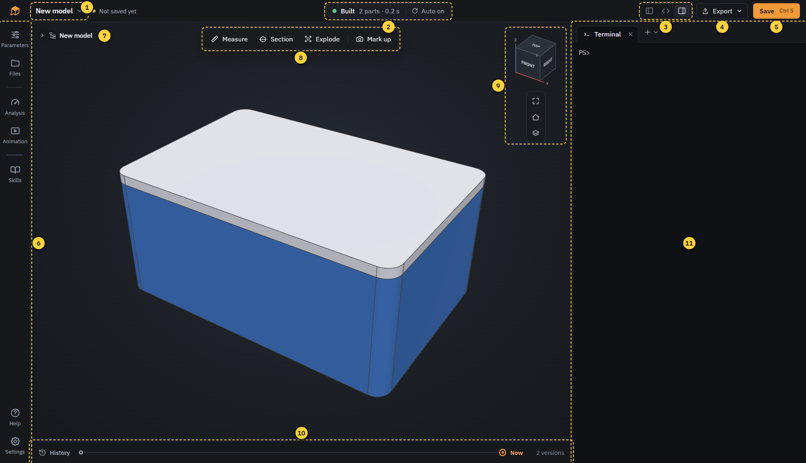

1. **Model menu**: new model, new from CadQuery script, open, recent models, save as. Next to it: whether the model is saved.
2. **Build status**: "Built" when the model is up to date, "Build failed" if the code has an error. Click for details. With "Auto on" the model is rebuilt whenever the code changes.
3. **Columns**: show or hide the sidebar, the code and the agent (Ctrl 1, Ctrl 2, Ctrl 3).
4. **Import**: add files such as STEP models, images or sketches to `inputs/`, where the agent can use them. Dragging files or folders into the window does the same.
5. **Export**: write parts as STL, STEP and other formats.
6. **Save**: saves the model as a .soma file and adds a version to the history (Ctrl S).
7. **Sidebar**: parameters, files, analysis, animation, skills, help and settings.
8. **Structure tree**: the parts of the model. Click the arrow to expand it.
9. **Tools**: measure, section, explode and mark up.
10. **View cube**: click a side, edge or corner to look from there.
11. **History**: every saved version. Click a dot to look at it.
12. **Agent**: the terminal where you talk to the agent.

The logo at the top left opens the start page.

## Start page

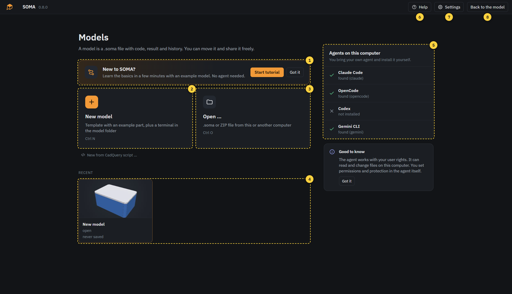

1. **New model**: starts from a small example (a box with a lid) and opens a terminal in the model folder (Ctrl N). The arrow next to it also offers **From CadQuery script**, which starts from an existing CadQuery script instead (see "CadQuery scripts"), and **Open folder**, which uses SOMA in a folder of yours (see "Your own folder").
2. **Open**: opens a .soma or ZIP file (Ctrl O).
3. **Tutorial**: a short guided tour of the app with an example model. No agent needed. The cross hides the card.
4. **Recent**: models you worked on, the newest first. The field above filters them by name. "Open" marks the model that is open right now, "never saved" one that was never saved as a .soma file. The bin on a card removes the model from this computer, a saved .soma file stays.
5. **Agents**: the agents SOMA found. Any other agent that runs in a terminal works too. You install them yourself, SOMA does not bring one.
6. **Help**: this guide (F1).
7. **Settings**: viewer, shortcuts, skills, storage and version.
8. **Back to the model**: returns to the open model, it shows the model's name (Esc).

As long as there is no model on this computer, two large cards for a new and an opened model take the place of Recent.

When a newer version of SOMA is available on GitHub, a small orange label appears next to the version number at the top
left. Clicking it opens the download page in your browser; SOMA downloads and installs nothing by itself. If the check
fails, a grey label says so. Settings > About > **Check for new versions** turns the check off.

**Start tutorial** opens a new example model called "Tutorial" and walks you through the window in ten steps: starting
the agent, the code, clicking a part, measuring, marking up, parameters, history, saving and export, and help. An orange
frame shows where to look, and you can try everything right away. Back, Skip and Next move through the steps, Esc ends
the tour. To see it again, click **Start tutorial** at the top of Help. If you leave the example model unchanged, it
disappears like any new model you did not change.

## The agent

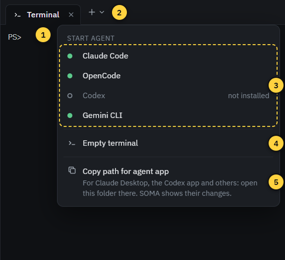

1. **Tabs**: each tab is an agent or a terminal, running in the model folder.
2. **New tab**: opens the menu below.
3. **Start agent**: starts one of the agents found on this computer.
4. **Empty terminal**: a plain command line, for example for `soma build`.
5. **Copy path for agent app**: copies the model folder. Open it in an agent app such as Claude Desktop or the Codex
   app, and SOMA shows its changes like those of an agent in a tab.

Type your wishes into the agent and press Enter. Everything with **Send to agent** (a part, a measurement, an error,
a drawing) puts a short note into the agent's input. Add your own words, then press Enter. You can also drag a file
from Files into the terminal to name it.

The agent works with your user rights. Permissions and safety settings are part of the agent, not of SOMA.

## Viewer

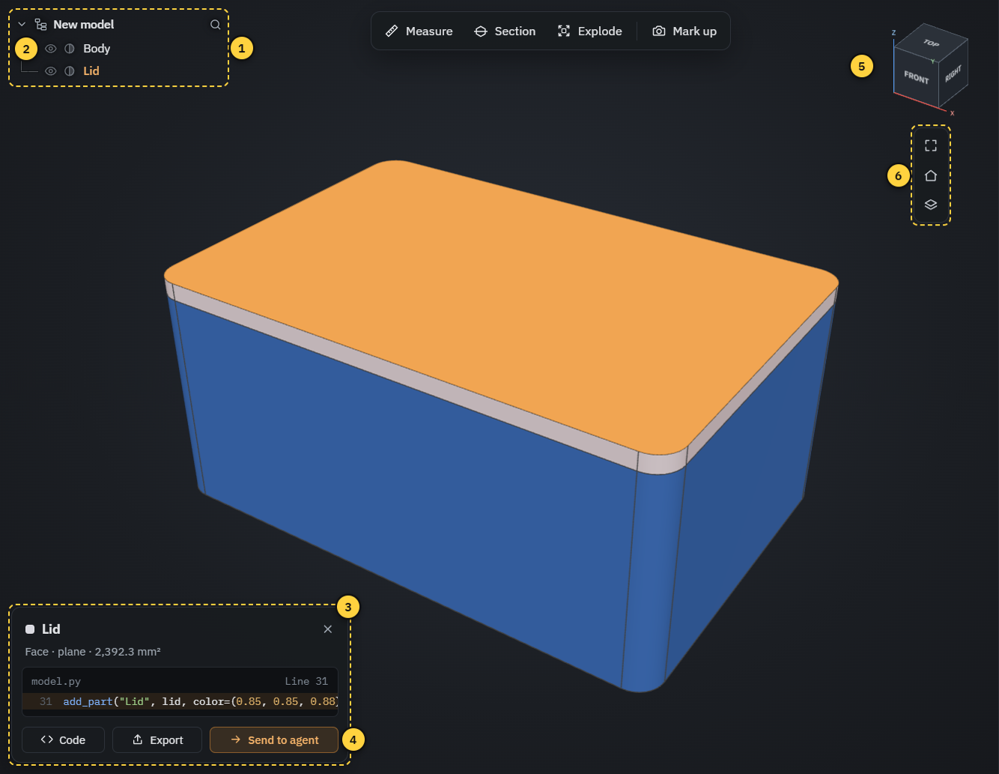

1. **Structure tree**: click a name to select the part. The search finds parts by name.
2. **Hide and transparent**: the eye hides a part, the half circle makes it transparent. Drag across several eyes to hide many at once.
3. **Selection card**: the selected part with its face and the line in the code. "Code" jumps there, "Export" saves only this part.
4. **Send to agent**: tells the agent which part and face you mean.
5. **View cube**: click to look from a side, drag to rotate.
6. **Fit, default view, axes, display**: fit the model into the view, back to the default view, origin and axes on and off (red X, green Y, blue Z, like on the view cube), and the display menu (edges, wireframe, transparent, origin and axes, front, top and other views).

Mouse (default): left drag rotates, right drag pans, the wheel zooms to the mouse position. A double-click sets the
pivot. You can switch to the mouse buttons of SolidWorks, Fusion 360, Onshape and others in Settings, Viewer.

Click selects a part, Ctrl+click adds more. Right-click a part for isolate, hide, transparent, zoom, code and agent.
Keys: H hides, Shift H shows all, I isolates, T makes transparent, Esc clears the selection.

## Tools

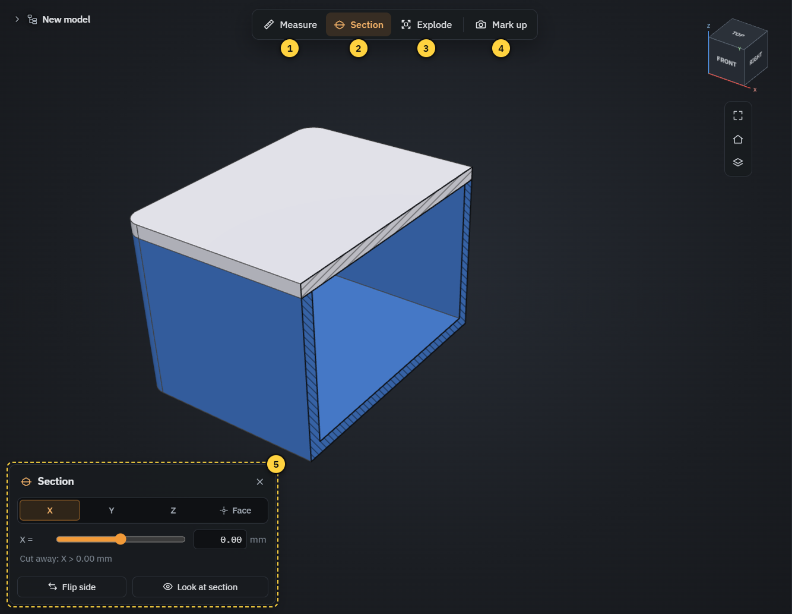

1. **Measure**: click a face or edge for its size, a second one for distance and angle. The values are exact.
2. **Section**: cuts the model open along X, Y, Z or parallel to a face. Move the plane with the slider or type a value.
3. **Explode**: pulls the parts apart. Plays the disassembly step by step and can send the order to the agent.
4. **Mark up**: draw on a picture of the view for the agent (see below).
5. **Tool card**: settings of the active tool. The × closes the tool. None of the tools change the model.

## Mark up

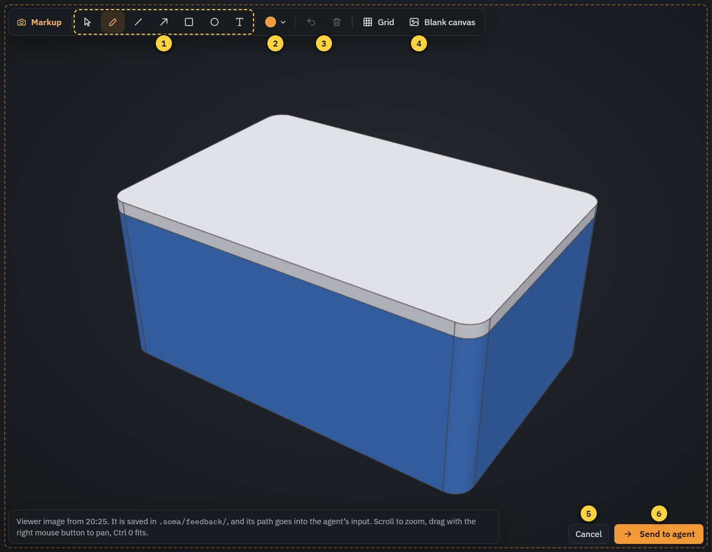

1. **Drawing tools**: select, pen, line, arrow, rectangle, circle and text.
2. **Color**: color of the next shape, or of the selected one.
3. **Undo and delete**: Ctrl Z undoes, Del deletes the selected shape.
4. **Grid and blank canvas**: a grid to draw straight, or an empty sheet for a sketch instead of the model.
5. **Cancel**: discards the drawing (Esc).
6. **Send to agent**: saves the picture in the model and passes it to the agent. Then write what you want, for example "make this hole bigger".

Mark up is the quickest way to show the agent what you mean: draw an arrow, write a dimension, circle a spot.

## Sidebar

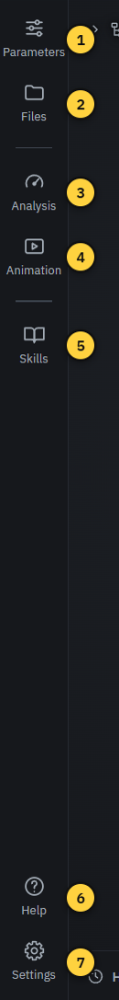

1. **Parameters**: values of the model you can change yourself, such as sizes, counts or angles. The model rebuilds right away. The agent decides which values appear here. The arrow next to a changed value brings back the agent's value.
2. **Files**: all files of the model. Click one to open it next to it.
3. **Analysis**: results the agent calculated, such as strength (FEM), wall thickness, overhang or clearance. Click one to see it in color on the model, with its report.
4. **Animation**: motion the agent made, for example an assembly sequence. Click one to play it in the viewer, "Make video" writes an MP4.
5. **Drawings**: all technical drawings of the model in one view, next to the viewer (no sidebar). See "Drawings" below.
6. **Skills**: rule sets for the agent, such as 3D printing, CNC or tolerances. Off, On demand (the agent reads them when the topic comes up) or Always.
7. **Help**: this guide (F1).
8. **Settings**: see below.

A dot on Analysis, Animation or Drawings means the agent made something new you have not looked at yet.

## Drawings

Ask the agent for a technical drawing ("Make a drawing of the bracket with all dimensions"). It writes `drawings/*.py` and builds the sheets with `soma drawing build`. "Drawings" on the left shows all sheets one after another in the code column; click it again to close the column.

- Above each sheet: size, scale, number of views and dimensions, "older than the code" when the model changed since, and the warnings of the check (click to list them, click a warning to open its line). The buttons open the drawing's code or the DXF, build the sheet again or send it to the agent.
- Point at a view or a dimension on the sheet to highlight it. Click it to see it on the model: a view turns the camera to its direction, a section sets the section tool to the same plane, a detail zooms in, a dimension shows its points and value. The card below has "Code" and "Send to agent". Escape clears it.
- The bar of the viewer switches between all pages and single pages, shows page previews on the left and fits the page width or the whole page. Select text and click "Quote to agent" to send it with its page.
- "Export" at the top saves all sheets as one PDF, or each sheet as PDF, DXF or both into a folder. The export button above a sheet saves just that sheet.

## Files and code

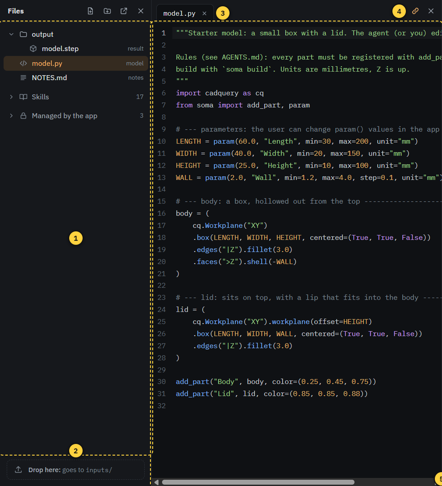

1. **File tree**: the model's files. Right-click for new, rename, show in Explorer and delete. "Managed by the app" holds files SOMA writes itself.
2. **Drop zone**: drop STEP files, images or sketches here. They go to `inputs/`, where the agent can use them.
3. **Open files**: one tab per open file.
4. **Linked to selection**: when on, clicking a part in the viewer jumps to its code.
5. **Editor**: you can edit the code yourself. Ctrl S saves the file and builds. If the agent changes the same file, SOMA asks before anything is overwritten.

Markdown files (such as `NOTES.md`) open as a document, PDF and DXF files open as a drawing.

Click a STEP file (`.step`, `.stp`) to look at it in the viewer. A banner names the file. Measure, Section, Explode and the
structure tree work as usual, but the parts have no link to code, and Animation and Analysis stay off. Builds of your model
wait until you click **Back to model**. When the file changes on disk, the viewer loads it again. Large files can take a
while the first time, after that they open from the preview cache.

## Saving and history

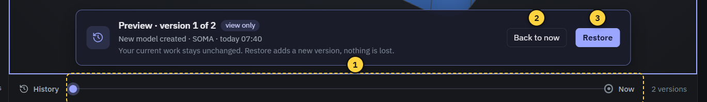

1. **Timeline**: one dot per version, the newest on the right. The agent adds versions as it works, Save adds one too.
2. **Back to now**: leaves the preview.
3. **Restore**: makes the version you are looking at the current one. It is added as a new version, nothing is lost.

A model is a single `.soma` file with code, results and the whole history. The first Save asks where to put it,
after that Ctrl S saves to the same file. Copy or send the file like any other document.

## Export

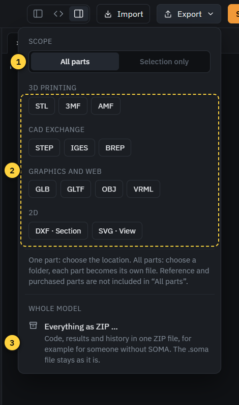

1. **Scope**: all parts, or only the selected one.
2. **Formats**: for 3D printing (STL, 3MF), CAD (STEP, IGES), graphics and 2D (DXF, SVG). All parts become one file per part in a folder you choose.
3. **Everything as ZIP**: the whole model with code, results and history, for someone without SOMA.
4. **As CadQuery script**: the model as plain CadQuery for CQ-editor, VS Code with ocp_vscode and other tools, without SOMA.

Reference parts (for example an imported circuit board) are not included in "All parts".

## CadQuery scripts

SOMA works with plain CadQuery scripts in both directions.

- **In:** **New from CadQuery script** in the model menu makes a new model from a `.py` file. The script stays as it is, the
  original is kept in `inputs/`. Scripts for CQ-editor (`show_object`), for VS Code (`ocp_vscode`) or with a variable
  `result` build in compatibility mode: the build shows a warning, the parts take their names and colors from there. Ask
  the agent to convert the script to `add_part()` and `param()`, then you get groups and the Parameters panel.
- **Out:** **As CadQuery script** in the Export menu writes one `.py` file. Your code stays the same, only the `from soma
  import` lines are replaced by a marked block that provides `add_part()`, `param()` and the standard parts. The values
  from the Parameters panel are in it. A model with modules in `parts/` becomes a folder with `soma_compat.py`. Animations,
  drawings and analyses stay in SOMA.
- **Back again:** import an exported script with **New from CadQuery script**. The block is removed, your original imports
  and the values of the Parameters panel come back. Leave the block unchanged, otherwise SOMA keeps it as it is.

The block and the standard parts are under the Apache License 2.0, so the exported script is yours like any model.

## Your own folder

**Open folder** (model menu, or the arrow next to New model) uses SOMA in a folder of yours, for example a Git repository.
The folder itself is the model: there is no .soma file to save, and your files stay where they are.

- **Entry point:** `model.py` if there is one. Otherwise SOMA asks which script builds the model (plain CadQuery with
  `show_object` or `result` works too), or creates `model.py` from the template.
- **Before anything changes**, SOMA lists what it creates and what it changes, with Cancel. It creates `.soma/` (app
  data, cache and skills, with its own `.gitignore` for the intermediate results) and `output/`. It adds a marked section
  for SOMA to `AGENTS.md` and a line pointing to it to `CLAUDE.md`, or creates the two files. Changed files are backed up
  first. Packages the model needs go into `.soma/requirements.txt`, a `requirements.txt` of yours stays as it is.
- **Git:** SOMA creates no repository and commits nothing here. If the folder is a repository, the history shows its
  commits. A version shows in the viewer if its commit contains `output/model.step`. **Restore** is not available:
  commit yourself or ask the agent.
- **Saving:** Ctrl S writes the editor's changes into the folder. **Export › Everything as ZIP** makes a copy as a file,
  without the Git history.
- **Start page:** the card says "Folder". The bin only removes it from the list, the folder stays. If you move or rename
  the folder, the card says "folder missing": open it again with **Open folder** at its new place.

## Settings

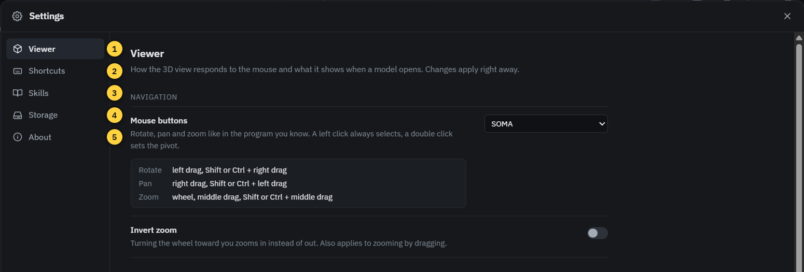

1. **Viewer**: mouse buttons like in your CAD program, zoom direction, perspective or orthographic, display when a model opens, decimal places of measurements.
2. **Shortcuts**: all keys and mouse actions.
3. **Skills**: edit the built-in skills or write your own. They are available in every model.
4. **Storage**: how much space SOMA's data takes, and clearing the preview cache.
5. **About**: versions, components and the agents found, the folders of SOMA including its logs, and whether the start page checks GitHub for new versions.

## When something goes wrong

- **Build failed**: a red card in the viewer shows the error and the line. "Send to agent" asks the agent to fix it, "Open code" shows the line. The viewer keeps showing the last model that worked.
- **Warning sign next to the model name**: SOMA found a problem in the model folder (for example a missing file). It only reports, it does not repair anything by itself. Ask the agent or fix it yourself.
- **Building takes long**: turn off "Auto on" in the build status and build with Ctrl B when you are ready.
- **The agent does not start**: check under "Agents" on the start page whether it is installed.
- **Reporting a problem**: "Copy system info" under Settings > About copies the versions and the end of SOMA's log, paste it into the bug report. The full log is in the folder "Logs" there. It stays on your computer, SOMA sends nothing by itself.
